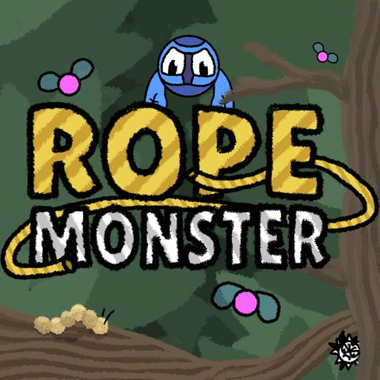

# Rope Monster

[](https://github.com/miguelrg14/Rope-Monster/actions/workflows/ci.yml)




A casual 2D mobile game made in Unity by a team of three students at ESNE (mobile
development course). You guide a little monster up a vertical level while it drags a
friend hanging from a rope: dodge traps and enemies, collect coins and keep climbing
before the acid catches you.

- **Play in the browser:** https://miguelrg14.github.io/Rope-Monster/
- **Android APK:** [Releases](https://github.com/miguelrg14/Rope-Monster/releases)
- **itch.io page:** https://martinx902.itch.io/rope-monster

<br clear="right">

## Team and credits

| Person | Role | Work in this repository |
|---|---|---|
| **Miguel Rodríguez Gallego** | Game design, UI and audio | UI design and main-menu code, level design of the 9 levels, all music and sound effects |
| Martín Pérez Villabrille | Programming | Gameplay code: rope physics (Verlet), player, enemies, parallax, saving, shop and wardrobe logic |
| Juan Pedro Muñoz Herreruela | Art | Backgrounds, characters, skins, obstacles, animations and UI art |

### My contributions

- **UI design and menu implementation.** Main menu, options, level select, shop and
  wardrobe screens, and the code that drives them (`RopeMonster/Assets/Scripts/Menu`).
- **Level design.** The 9 levels across three biomes: jungle, crypt and underworld.
- **Audio.** Both music tracks and every sound effect, composed and recorded from
  scratch in FL Studio and Audacity. The original FL Studio projects and foley
  recordings are in [`audio-source/`](audio-source).

The gameplay code and the art belong to my teammates and are kept as they made them,
except for one minimal fix to the save system, done with the team's code left otherwise
untouched (see below).

## Repository layout

| Path | Contents |
|---|---|
| [`RopeMonster/`](RopeMonster) | Unity 6 project (open this folder in Unity Hub) |
| [`RopeMonster/Assets/Scripts/Menu/`](RopeMonster/Assets/Scripts/Menu) | Menu, level-select and audio-options code, in its own assembly (`RopeMonster.Menu`) |
| [`RopeMonster/Assets/Tests/`](RopeMonster/Assets/Tests) | EditMode and PlayMode tests |
| [`RopeMonster/Assets/Audio/`](RopeMonster/Assets/Audio) | Music, sound effects and the main audio mixer |
| [`audio-source/`](audio-source) | FL Studio projects (`music/`, `sfx/`) and raw foley recordings (`foley/`) |
| [`e2e/`](e2e) | Playwright test that plays the WebGL build in a headless browser |
| [`.github/workflows/`](.github/workflows) | CI, GitHub Pages deployment and tagged releases |

## Running the project

Requirements: [Git LFS](https://git-lfs.com) and Unity **6000.6.8f1** (Unity 6) with the Android
and/or WebGL build modules.

```bash
git lfs install
git clone https://github.com/miguelrg14/Rope-Monster.git
```

1. In Unity Hub, choose **Add project from disk** and select the `RopeMonster/` folder.
2. Open `Assets/Scenes/MainMenu.unity` and press **Play**. The game is designed for a
   portrait 9:16 screen. In the editor, use the mouse as a finger.
3. To build, go to **File > Build Settings** and pick **Android** or **WebGL**. The
   scenes are already in the right order.

## Design notes

- **Menu code in its own assembly.** `RopeMonster.Menu` only depends on uGUI and
  TextMesh Pro, so it compiles fast and can be tested in isolation. The rest of the game
  stays in `Assembly-CSharp`.
- **Navigation.** `MainMenuManager` keeps exactly one panel visible: the main menu or one
  sub-menu (options, wardrobe, levels or shop).
- **Volume in percent, mixer in decibels.** The sliders go from 0 to 100 %, and
  `VolumeSettings` converts that to decibels with `20·log10(p/100)`, clamped to -80 dB.
  As a result, 50 % sounds like half the volume instead of a linear dB fade.
  `VolumeController` saves the values through an `IVolumeStore` interface (PlayerPrefs
  in the game, an in-memory fake in tests).
- **Audio routing.** `MainAudioMixer` has `Music`, `SFX` and `UI` groups with exposed
  volume parameters. The menu and level music play through `Music`. `MenuAudio`
  adds click sounds to every button through the `UI` group: the purchase button plays
  "Buy" and the wardrobe plays "Equip skin". The saved volumes are applied in `Start`,
  because `AudioMixer.SetFloat` is ignored during `Awake`.
- **Level select.** `LevelSelectLoader` checks the index and that the scene is in the
  build before loading it.

### Fixed during the portfolio clean-up

- The level-select buttons 4 to 9 passed the wrong index. Button "4" opened level 5,
  level 4 could not be reached, and button "9" went out of range.
- The audio mixer had no exposed parameters, so the volume sliders did nothing. The
  sliders also used a raw -80…0 dB range while the defaults were set to 50.
- Saved volumes were only applied once the options panel had been opened.
- The in-level music did not loop.
- **Save system (teammate's code, minimal fix):** on a first launch with no save file,
  `SavingSystem` tried to serialise `null` and left the file locked, so the game crashed
  on start and every later save failed. It now starts a new game when there is no save
  or the file is empty or corrupted, and closes its files with `using`.
- Leftovers were removed: unused scenes, placeholder art, unused fonts, a credits prefab
  from another project, dead scripts, duplicated audio exports and FL Studio
  auto-saves. The audio was converted from WAV to Ogg Vorbis, cutting it from 130 MB to
  18 MB.

## Tests

| Suite | Type | What it checks |
|---|---|---|
| `VolumeSettingsTests` | EditMode | Percent ⇄ dB curve, clamping, labels, one mixer parameter per channel |
| `VolumeControllerTests` | EditMode | Defaults, clamping of saved values, reset |
| `MainAudioMixerAssetTests` | EditMode | The mixer exposes `musicVolume`, `sfxVolume` and `uiVolume`, and has the `Music`, `SFX` and `UI` groups |
| `MainMenuManagerTests` | EditMode | Only one panel visible at a time, going back to the main menu, missing panels |
| `LevelSelectLoaderTests` | EditMode | Index validation |
| `AudioOptionsManagerTests` | EditMode | Sliders load saved values, save changes and update their labels |
| `MenuAudioTests` | EditMode | Sound priority: specific button, then group, then default click |
| `MainMenuSceneTests` | EditMode | Build settings order, and **every level button opens the level written on it** |
| `GameSmokeTests` | PlayMode | The real scenes: the menu boots, buttons navigate, the mixer applies dB values, *Play* and level select load the right level, and all 9 levels load and run |
| `e2e/tests/smoke.spec.js` | Browser (Playwright) | The WebGL build loads in Chromium, renders the menu and starts a level |

Run them in Unity from **Window > General > Test Runner**. The browser test needs a
WebGL build in `e2e/site`:

```bash
cd e2e
npm ci
npx playwright install chromium
npx playwright test
```

## Continuous integration

- **`ci.yml`** runs on every push and pull request. It runs the EditMode and PlayMode
  tests with [GameCI](https://game.ci), builds WebGL, plays the build in headless
  Chromium and, on `main`, deploys it to GitHub Pages.
- **`release.yml`** runs when a `v*` tag is pushed. It builds the Android APK and a
  WebGL zip and attaches both to a GitHub release.

## License

This licence only covers my part of the project: the menu code, tests and CI are under
MIT, and the music and sound effects are under CC BY 4.0. The gameplay code and the art
belong to my teammates and all rights are reserved. See [LICENSE](LICENSE) for the
details.
